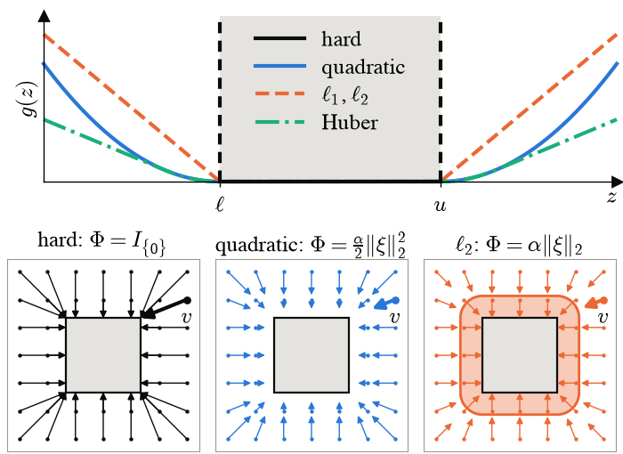
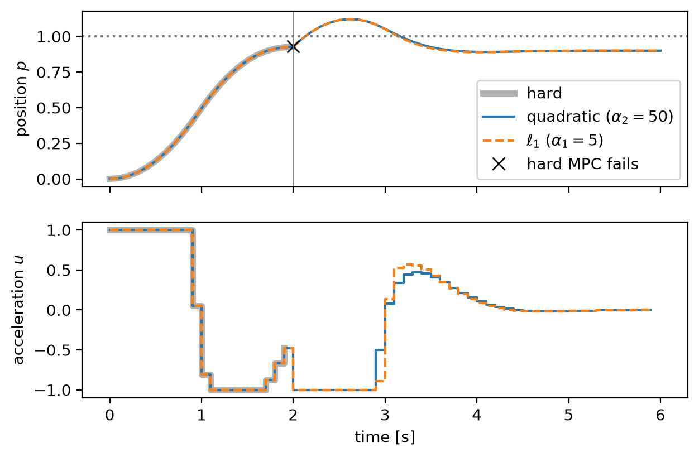
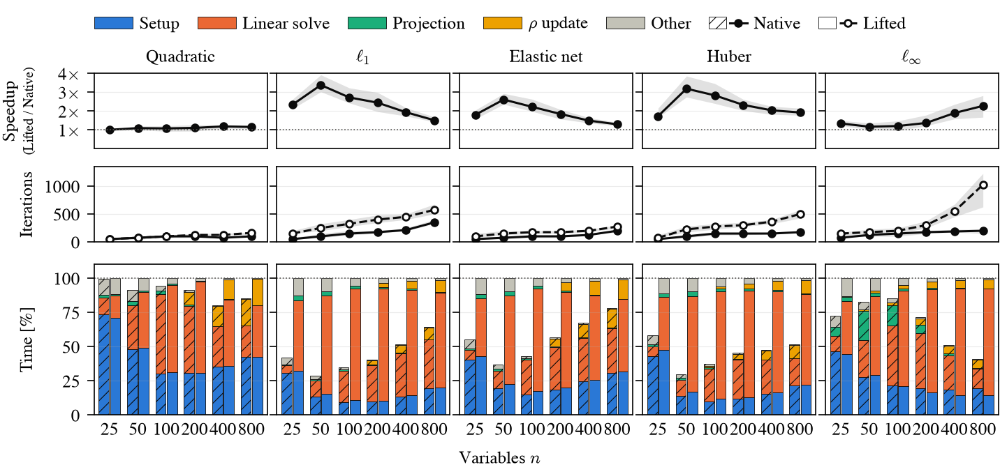
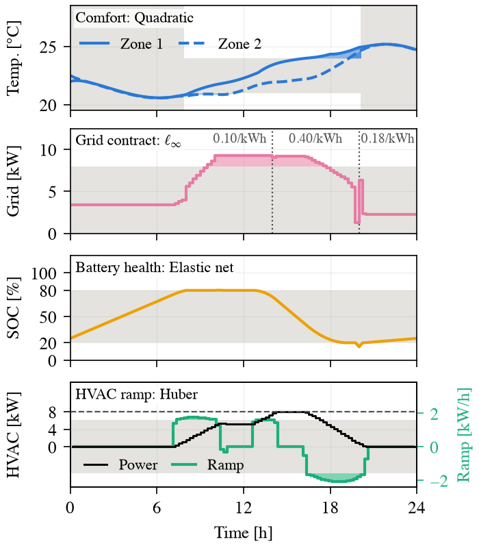

# OSQPSlack

Code to reproduce the results of the paper

> **Efficient ADMM for Soft-Constrained Quadratic Programs via Generalized Slack Projections**
> Roland Schwan, Thomas Lew, Brian Plancher

Soft constraints `l <= Ax + xi <= u` with a penalty `Phi(xi)` are usually handled by adding slack variables, which makes the QP larger. The paper shows that ADMM can handle general slack penalties without growing the problem: the only change is a *generalized slack projection* in place of OSQP's box projection. This repository contains a modified [OSQP](https://osqp.org) that implements this, and the scripts behind every figure and table in the paper.

<p align="center"></p>

## Repository layout

```
external/osqp/          modified OSQP C solver           (submodule: A2R-Lab/osqp, branch general_slack)
external/osqp-python/   its Python interface             (submodule: A2R-Lab/osqp-python, branch general_slack)
osqpslack/              shared code: penalties and liftings, problem generators, plot style
experiments/            one run (data) and one plot (figures) script per experiment
notebooks/              tutorial: soft-constrained MPC
data/                   results used in the paper
figures/                figures and table of the paper (PDF/TeX), plus PNGs for this README
```

## Using the solver

After `setup`, one call softens any subset of the constraint rows:

```python
import osqp

solver = osqp.OSQP()
solver.setup(P, q, A, l, u)
solver.setup_penalty(
    penalty_type,         # per row: osqp.PenaltyType.OSQP_PENALTY_{NONE, L1L2, HUBER, NORM2, NORMINF}
    alpha1=alpha1,        # weights: scalars or per-row arrays
    alpha2=alpha2,
    delta=delta,
    group_id=group_id,    # row groups for NORM2/NORMINF
)
result = solver.solve()
xi = solver.slack(result.x)
```

## Example: soft-constrained MPC

[`notebooks/mpc_example.ipynb`](notebooks/mpc_example.ipynb) is a step-by-step tutorial on a cart that must stay below a position limit:

1. a disturbance makes the hard MPC infeasible, while the soft MPC recovers;
2. quadratic vs. $\ell_1$ penalty;
3. updating the penalty weights online, without a new setup.

<p align="center"></p>

## Installation

You need Python ≥ 3.10, CMake, and a C compiler.

```bash
git clone --recursive https://github.com/A2R-Lab/OSQPSlack.git
cd OSQPSlack
python -m venv .venv && source .venv/bin/activate
make install
```

`make install` builds the modified OSQP from `external/` and installs it into the virtual environment as `osqp`, together with the other dependencies. Without `make`, run

```bash
SKBUILD_CMAKE_DEFINE="OSQP_SOURCE_DIR=$PWD/external/osqp" pip install -r requirements.txt
```

### Only the modified OSQP

To use the solver in your own project, install just the modified `osqp` package. It replaces a regular `osqp` installation, so use a separate virtual environment. Directly from GitHub:

```bash
pip install "git+https://github.com/A2R-Lab/osqp-python.git@general_slack"
```

or, from a clone of this repository (builds exactly the pinned submodule versions):

```bash
SKBUILD_CMAKE_DEFINE="OSQP_SOURCE_DIR=$PWD/external/osqp" pip install ./external/osqp-python
```

## Reproducing the results

```bash
make figures   # data/ -> figures/                 (seconds)
make data      # re-run all experiments -> data/   (about 15 minutes)
```

The data in `data/` is what the paper reports, so `make figures` alone reproduces every figure and table. `make data` re-runs the experiments; timings depend on the machine (the paper's were measured single-threaded on a MacBook Pro with an M5 Pro processor).

| Paper | Script | Output |
|---|---|---|
| Generalized slack projection (figure) | `experiments/slack_projection.py` | `figures/slack_projection.pdf` |
| Random sparse QPs (figure and timing table) | `experiments/scaling_run.py`, `experiments/scaling_plot.py` | `data/scaling.csv`, `figures/scaling.pdf`, `figures/scaling_times.tex` |
| Building energy management (figure and timings in the text) | `experiments/energy_hub_run.py`, `experiments/energy_hub_plot.py` | `data/energy_hub.{csv,json}`, `figures/energy_hub.pdf` |

### Random sparse QPs

Native slack penalties against explicit lifting to a standard QP, on random sparse QPs with `n` variables and `n` soft constraints (100 instances per point).



### Building energy management

A one-day schedule for a building with two thermal zones, a battery, and a grid connection, mixing a different penalty for each soft constraint group.

<p align="center"></p>

## AI disclaimer

LLM tools, including Claude, have been used to help write the code in this repository. All code was reviewed by humans, and the authors take full responsibility for its correctness.

## License

The code in this repository is licensed under the MIT license. The modified OSQP in `external/` keeps OSQP's Apache 2.0 license.
